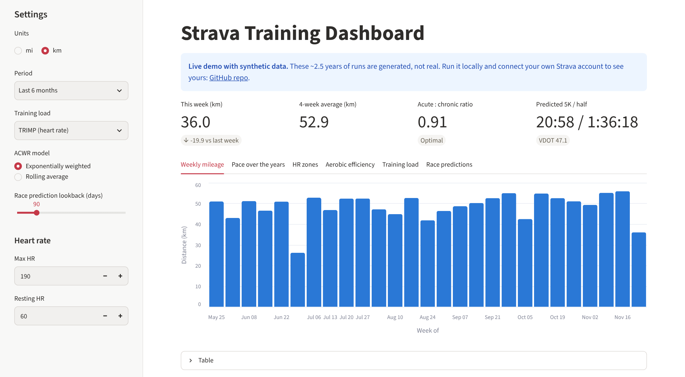
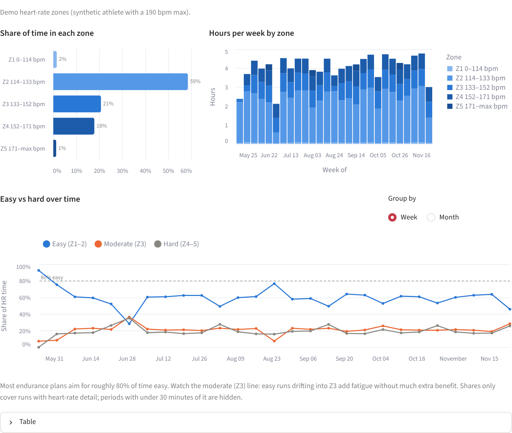
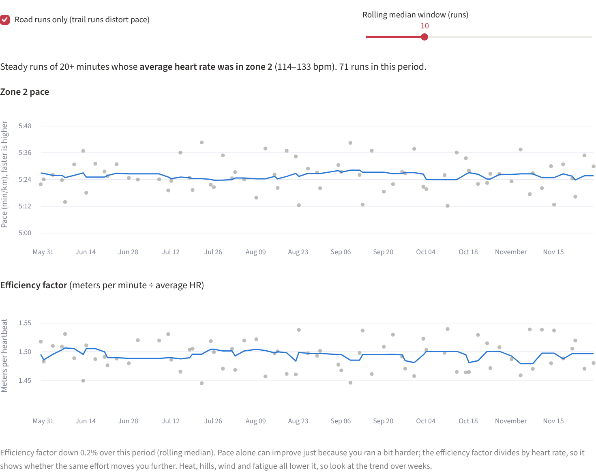
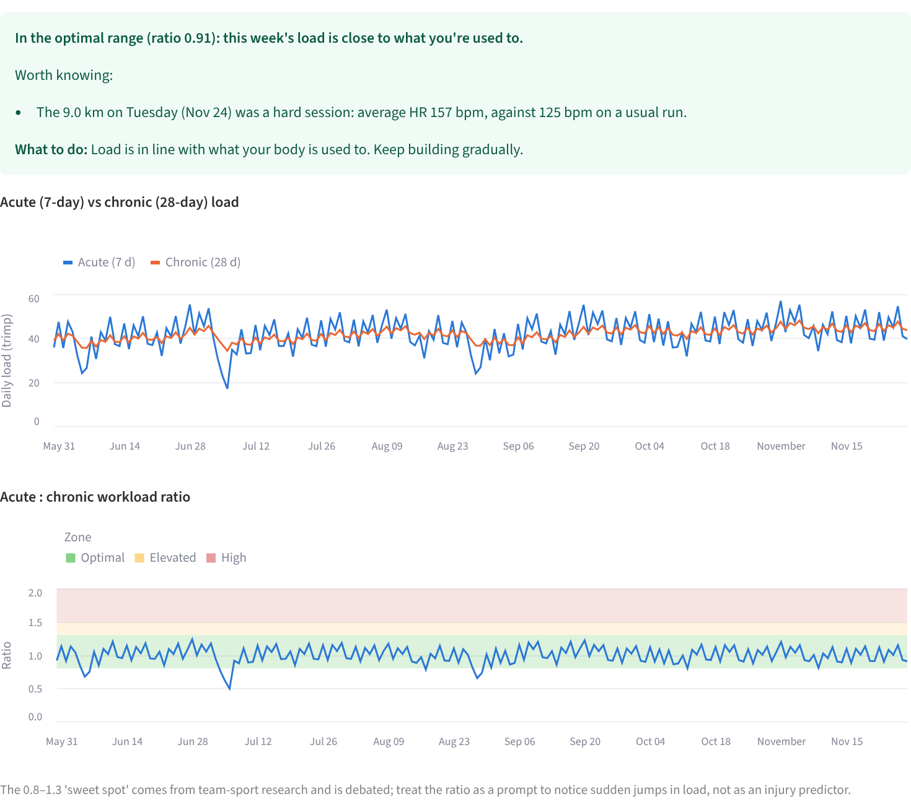
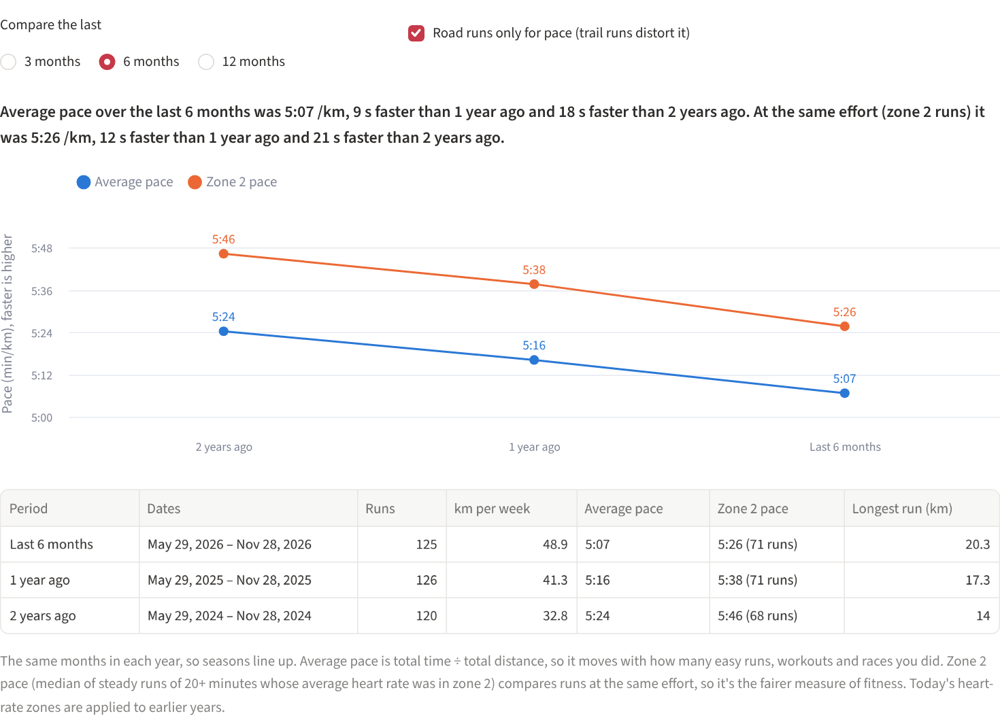

# Strava Training Dashboard

[](https://github.com/GuillermoMorfin/strava-dashboard/actions/workflows/ci.yml)

[](LICENSE)

Pull your running activities from the Strava API into a local DuckDB database and turn them
into training insights in an interactive Streamlit dashboard.

**[▶ Try the live demo](https://guillermomorfin-strava-dashboard.streamlit.app)** (synthetic data, nothing to install)



<table>
  <tr>
    <td><br><sub><b>HR zones</b>: time in zone, and the easy/moderate/hard split week by week against an 80% easy target</sub></td>
    <td><br><sub><b>Aerobic efficiency</b>: pace and meters per heartbeat on steady zone 2 runs</sub></td>
  </tr>
  <tr>
    <td><br><sub><b>Training load</b>: acute vs chronic load and the ACWR</sub></td>
    <td><br><sub><b>Pace over the years</b>: the same months this year, 1 year ago and 2 years ago</sub></td>
  </tr>
</table>

## What this project shows

- **End-to-end data pipeline:** OAuth 2.0 login to the Strava API, incremental sync that
  respects rate limits and resumes where it stopped, and storage in DuckDB.
- **Analytics grounded in sports science:** time in heart-rate zones from second-by-second
  data, 80/20 intensity balance, aerobic efficiency, year-over-year pace, training load (Banister
  TRIMP, acute:chronic ratio) and race predictions, each with its assumptions and limits
  [documented](#how-the-metrics-are-calculated).
- **Insights, not just charts:** the dashboard says in plain words what changed and why, e.g.
  "20 s/km faster at the same effort than a year ago", or "elevated load: 3 days in a row, and
  Thursday was a hard session".
- **Tested, maintainable code:** ~110 automated tests (Strava API mocked, metrics checked
  against published tables and hand calculations), linting and CI on every push.
- **Shipped, privacy-first:** a deployed [live demo](https://guillermomorfin-strava-dashboard.streamlit.app)
  runs on synthetic data, so anyone can try it without an account, while real training data
  never leaves the runner's own machine.

## Why I built this

I run, and I wanted more from my training data than Strava's built-in charts: how my weekly
volume builds, how much time I really spend in each heart-rate zone, whether a week's load
jumps too fast, and what recent efforts predict for race day. It was also a chance to build
the full path myself, from an OAuth-protected API to a local database, tested metric code
and an interactive dashboard.

## What it does

- **Weekly mileage**: distance, run count, hours and long run per week
- **Pace over the years**: average pace and zone 2 pace for the last 3, 6 or 12 months against the same months 1 and 2 years ago
- **Heart-rate zone distribution**: time in zone overall and per week, from second-by-second HR streams
- **Easy vs hard over time**: weekly or monthly share of easy (Z1–2), moderate (Z3) and hard (Z4–5) time against an 80% easy target
- **Aerobic efficiency**: pace and efficiency factor (meters per heartbeat) on steady zone 2 runs, to see whether your base is improving
- **Acute:chronic training load**: TRIMP, distance or duration load with EWMA or rolling ACWR,
  plus a plain-words diagnosis of why the ratio is where it is and what to do
- **Race predictions**: 5K / 10K / half / marathon by Daniels VDOT and Riegel

Everything runs locally. Your data and tokens never leave your machine except to talk to Strava.
The [live demo](https://guillermomorfin-strava-dashboard.streamlit.app) only ever shows
generated runs; it has no Strava connection.

**Built with:** Python, Strava REST API (OAuth 2.0), httpx, DuckDB, pandas, Streamlit and
Altair, pytest, ruff, GitHub Actions, Streamlit Community Cloud.

## Quick start (no Strava account needed)

```bash
python3 -m venv .venv && source .venv/bin/activate
pip install -e ".[dev]"

strava-dash demo                               # ~2.5 years of synthetic runs → data/demo.duckdb
strava-dash dashboard --db data/demo.duckdb    # opens http://localhost:8501
```

Requires Python 3.11+.

## Connecting your Strava account

<details>
<summary>Step-by-step setup: Strava API app, <code>.env</code>, authorization and sync</summary>

### 1. Create a Strava API application (one time)

1. Go to <https://www.strava.com/settings/api> and create an app.
2. Fill in any name, category and website (e.g. `http://localhost`).
3. Set **Authorization Callback Domain** to `localhost`. This must match the redirect
   URL the app uses (`http://localhost:8765/callback`), or Strava will reject the login.
4. Copy the **Client ID** and **Client Secret**.

### 2. Configure

```bash
cp .env.example .env
# edit .env: set STRAVA_CLIENT_ID and STRAVA_CLIENT_SECRET
```

`.env` and the token file are git-ignored. Never commit them.

### 3. Authorize

```bash
strava-dash auth
```

This opens Strava in your browser. Approve the request, leaving **"View data about your
private activities"** checked, and you'll land on a "You can close this tab" page.

What happens under the hood (OAuth 2.0 authorization-code flow):

1. A one-shot HTTP server starts on `127.0.0.1:8765` **before** the browser opens, so a
   busy port fails immediately (change it with `STRAVA_REDIRECT_PORT`, keeping the callback
   domain `localhost`).
2. The authorize URL requests scopes `read,activity:read_all,profile:read_all` and carries
   a random `state` value.
3. Strava redirects to `/callback?code=…&state=…&scope=…`. The app rejects the callback if
   `state` doesn't match (CSRF protection) or if `activity:read_all` wasn't granted.
4. The code is exchanged at `https://www.strava.com/oauth/token` for an access token
   (valid ~6 hours) and a refresh token.
5. Tokens are written atomically to `.strava_tokens.json` with `0600` permissions.

You only do this once. Every later command checks the token's expiry and refreshes it
automatically, saving the new refresh token (Strava may rotate it).

`profile:read_all` is optional. It lets the app read the HR zones from your Strava
profile. Without it, zones are estimated from max HR.

Use `strava-dash auth --no-browser` to print the URL instead of opening it.

### 4. Sync and view

```bash
strava-dash sync         # incremental: only runs newer than the latest one stored
strava-dash dashboard
```

| Command | What it does |
|---|---|
| `strava-dash sync` | Downloads new runs (Run, TrailRun, VirtualRun), your HR zones, and up to 50 HR streams |
| `strava-dash sync --streams 200` | Fetch more HR streams this time (each costs one API request) |
| `strava-dash sync --full` | Re-download every activity (picks up edits to old runs) |
| `strava-dash dashboard [--db PATH]` | Launch the dashboard; extra args go to `streamlit run` |
| `strava-dash demo [--db PATH]` | Write synthetic data (overwrites PATH) |

**Rate limits.** Strava limits requests per 15 minutes and per day; see your app's API
settings page for the exact numbers. One activity-list request returns 200 runs, but HR
streams cost one request each, so a first sync with years of history takes a few runs of
`sync`. Sync is resumable: activities are requested oldest-first and saved in batches,
so if Strava returns `429`, everything fetched so far is kept and the next run continues
from there.

</details>

## Configuration

<details>
<summary>Environment variables</summary>

Set these in `.env` or as environment variables.

| Variable | Default | Meaning |
|---|---|---|
| `STRAVA_CLIENT_ID` / `STRAVA_CLIENT_SECRET` | — | From your Strava API app (needed for `auth` and `sync`) |
| `STRAVA_REDIRECT_PORT` | `8765` | Port for the local OAuth callback |
| `STRAVA_DB_PATH` | `data/strava.duckdb` | DuckDB file |
| `STRAVA_TOKEN_PATH` | `.strava_tokens.json` | Where tokens are stored |
| `STRAVA_UNITS` | `mi` | Default units in the dashboard: `mi` or `km` |
| `MAX_HR` | highest max HR in your runs | Used for TRIMP and estimated zones |
| `RESTING_HR` | `60` | Used for TRIMP |

Units, max/resting HR, the period, and the load and ACWR models can also be changed in the dashboard sidebar.

</details>

## How the metrics are calculated

<details>
<summary>Methodology for each metric, with assumptions and limits</summary>

All metric code is in [`src/strava_dashboard/metrics.py`](src/strava_dashboard/metrics.py)
as pure pandas functions.

**Weekly mileage.** Runs are grouped by Monday-start week using the run's *local* start
time, and empty weeks show as zero.

**Pace over the years.** The same window (3, 6 or 12 months up to today) is compared with
the same months 1 and 2 years earlier, so seasons line up. *Average pace* is total moving time
÷ total distance of the window's road runs (trail runs are left out by default), so long runs
count more than short ones, and it moves with the mix of easy runs, workouts and races.
*Zone 2 pace* is the median pace of steady runs of 20+ minutes whose average HR was in zone 2:
it compares runs at the same effort, so it's the fairer measure of fitness. Today's zones are
applied to earlier years. Volume (runs, distance per week, longest run) counts every run.

**HR zones.** Time in zone comes from the per-second HR stream: each interval between
samples is credited to the zone of its starting sample, and gaps over 30 s (pauses) are
skipped. Zones come from your Strava profile when available, otherwise they're set at
60/70/80/90% of max HR. Streams are stored raw, so changing zones recomputes history
without re-downloading anything.

**Easy vs hard over time.** Zone time is grouped into easy (Z1–2), moderate (Z3) and hard
(Z4–5) and shown as a share per week or month. Weeks with less than 30 minutes of HR data are
hidden, since one run would swing them. It only covers runs whose HR stream has been fetched
(`sync --streams N`). The 80% line is the usual polarized/80-20 guideline, not a hard rule.

**Aerobic efficiency.** Uses runs of 20+ minutes whose *average* HR falls in zone 2, road runs
only by default (trail and hills distort pace). For each run it shows pace and the
**efficiency factor**, `EF = speed (m/min) ÷ average HR`, i.e. meters covered per heartbeat,
each with a rolling median. Faster pace at the same HR, or a rising EF, means better aerobic
fitness. Heat, wind, hills, fatigue and how the run was paced all lower EF, and zones are
today's zones applied to older runs, so read it as a trend over weeks rather than per run.

**Training load.**
- *TRIMP* (default): Banister's `minutes × HRr × 0.64 × e^(1.92 × HRr)`, where
  `HRr = (avg HR − resting) / (max − resting)`. Runs without HR are estimated from your
  median TRIMP per minute, and the dashboard shows what share was estimated. (1.92 is the
  standard male coefficient; 1.67 is used for women. Change `k` in `banister_trimp` if needed.)
- *Distance* or *Duration*: simpler options that need no heart-rate data.

**Acute:chronic workload ratio.** Daily load (rest days count as 0) feeds two models:
- *EWMA* (default): exponentially weighted means with α = 2/(N+1) for 7 and 28 days
  (Williams et al., 2017). Recent days weigh most, so the ratio reacts quickly to the last
  few days (three runs in a row can lift it into "elevated", and one rest day can bring it
  back), and there's no sudden drop when a big day leaves a rolling window.
- *Rolling*: plain 7-day ÷ 28-day means.

The ratio stays blank until 28 days of history exist. The bands (<0.8 low,
0.8–1.3 "optimal", 1.3–1.5 elevated, >1.5 high) come from team-sport research and are
debated, so treat a spike as a prompt to look at your training rather than as an injury
forecast.

**Load diagnosis.** Above the training-load charts, a box explains the latest ratio in plain
words. It compares the last 7 days with the 4 weeks before and names what stands out:
runs on 3 or more consecutive days, a session whose average HR is well above a usual run
(above the 80th percentile and at least 8 bpm over the median), most of the week's load in
the last 3 days, 15% more or less distance than a usual week, a run 25% longer than the usual
long run, or a light week that lowered the 4-week base. It ends with what to do for that band.

**Race predictions.** The app takes the run with the highest **VDOT** (Daniels–Gilbert
oxygen-cost equations) among runs of 3 km or more in the lookback window (90 days by
default), ignoring implausible GPS speeds. It then predicts each distance two ways:
- *VDOT*: solves the same equations for the time at each distance (matches Daniels'
  published tables within seconds; see the tests).
- *Riegel*: `T2 = T1 × (D2/D1)^1.06`.

Predictions are only as good as the effort behind them. A recent race or hard time trial
works best, and marathon predictions run optimistic without long-run training.

</details>

## For developers

<details>
<summary>Project layout, database schema, hosted demo and tests</summary>

### Project layout

```
src/strava_dashboard/
  config.py     settings from env / .env
  auth.py       OAuth: authorize URL, callback server, token exchange/refresh/storage
  client.py     Strava API client (activities, zones, HR streams, 429 handling)
  db.py         DuckDB schema, upserts, loaders
  sync.py       incremental, resumable sync
  metrics.py    weekly volume, pace, HR zones, intensity split, efficiency, TRIMP, ACWR, VDOT/Riegel
  dashboard.py  Streamlit app
  demo.py       synthetic data generator
  cli.py        `strava-dash` command
streamlit_app.py  entry point for the hosted demo (always synthetic data)
tests/          pytest suite (HTTP mocked; dashboard smoke-tested with Streamlit AppTest)
```

### Database schema

| Table | Contents |
|---|---|
| `activities` | One row per run: distance, times, HR averages, `start_date` (UTC) and `start_date_local`, plus the full `raw` JSON |
| `hr_streams` | `time_s[]` and `heartrate[]` per run; empty lists mean "fetched, no HR" |
| `hr_zones` | Your Strava HR zones (`max_bpm = -1` is open-ended) |

You can query the data directly:

```bash
duckdb data/strava.duckdb "SELECT date_trunc('month', start_date_local) m, round(sum(distance_m)/1609.344) mi FROM activities GROUP BY m ORDER BY m"
```

### Hosted demo

`streamlit_app.py` is the entry point used on Streamlit Community Cloud. It always serves
synthetic data: on first load each day it regenerates `data/demo.duckdb` (so the charts end
today) and runs the normal dashboard with a "synthetic data" banner. It never reads `.env`
credentials or your real database. To try it locally: `streamlit run streamlit_app.py`.

To deploy your own copy: fork the repo, then at <https://share.streamlit.io> create an app
from your fork with main file `streamlit_app.py` and Python 3.11 or newer. `requirements.txt`
installs the package. No secrets are needed.

### Running the tests

```bash
pip install -e ".[dev]"
pytest              # full suite; no network or Strava account needed
ruff check . && ruff format --check .
```

Tests mock all HTTP with `httpx.MockTransport`, use in-memory DuckDB, check the metrics
against known values (Daniels' VDOT tables, hand-computed TRIMP/ACWR), and render the
dashboard headlessly against demo data.

</details>

## Troubleshooting

<details>
<summary>Common problems and fixes</summary>

| Problem | Fix |
|---|---|
| Strava says `redirect_uri invalid` | Set the app's Authorization Callback Domain to `localhost` |
| `Missing required scope(s): activity:read_all` | Re-run `strava-dash auth` and keep the private-activities box checked |
| `Can't listen on port 8765` | Set `STRAVA_REDIRECT_PORT` to a free port |
| `Not authorized yet` | Run `strava-dash auth` |
| `Strava rate limit reached` | Wait ~15 minutes and run `sync` again. Progress is saved |
| Dashboard says database is locked | A `sync` is writing to it. Wait for it to finish |
| HR zone tab is empty | Run `sync` a few more times to fetch streams (`--streams N`) |
| An edited old run looks stale | `strava-dash sync --full` |

To disconnect the app, revoke it at <https://www.strava.com/settings/apps> and delete
`.strava_tokens.json`.

</details>

## License

[MIT](LICENSE)
